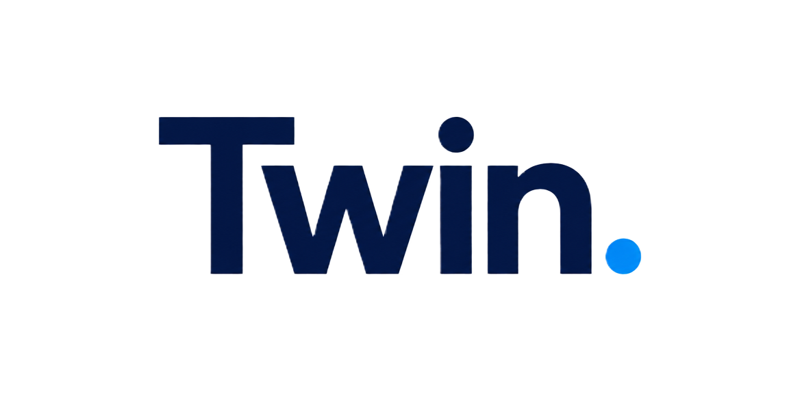

  

<h3 align="center">The full CRM for creators and agencies.</h3>

  Run your fans, your content, your sales and your AI twin from one place.

  <a href="https://twintechnologies.co/"><b>twintechnologies.co</b></a>
  &nbsp;&middot;&nbsp;
  <a href="mailto:contact@twinagency.co">contact@twinagency.co</a>

---

## What Twin is

Twin is a complete CRM built for creators and the agencies that manage them. Every fan, conversation, piece of content and dollar earned lives in one system, and an AI version of you works it around the clock.

It talks like you, sells like you, and keeps every relationship warm while you create.

## Everything in one platform

| | |
|---|---|
| **Fans and CRM** | Every fan profile, history, spend and status. Segments, notes and who to re-engage next. |
| **AI twin** | A clone of your voice and personality that chats, sends voice replies and keeps conversations going 24/7. |
| **Sales** | Paid photos, videos, voice content, bundles and tips, sold inside the conversation. |
| **Content library** | Upload once, organise, price and deliver. Previews, bundles and catalogues. |
| **Campaigns** | Re-engagement and broadcast tools that bring past fans back. |
| **Earnings and payouts** | Live revenue, per-creator reporting and payout tracking. |
| **Agency tools** | Run a whole roster: many creators, partner portals, permissions and cuts. |
| **Your rules** | You set limits, pricing and content. Controls for every behaviour. |
| **Multi-platform** | Telegram today, with more platforms connecting into the same CRM. |
| **API** | Read-only data API for your own dashboards and tools. |

## Our projects

**Twin CRM.** The core platform: fans, conversations, content, sales, campaigns, earnings and payouts in one dashboard, for creators and whole agencies.

**Twin AI.** The conversation engine behind every twin. It learns a creator's tone and personality, chats by text and voice, sends the right content at the right moment, and sells without being pushy. Prices and payments are controlled in code, never left to the AI.

**T-Social.** A Telegram Mini App with a Reels-style feed and a Trending view, built to showcase our creators and send fans straight into the conversation.

**FLIRT.** A creator platform where models sign up, upload their content and get an AI twin set up for them. [flirtw.me](https://flirtw.me)

**Re-engagement.** Tools that bring past fans back with campaigns, bundles and drip offers, sent safely and measured per creator.

**Payments.** Fans pay in Telegram Stars and TON, with every charge tracked and deduplicated so no sale is missed or double counted.

**Posting tools.** Schedule stories and channel posts for every creator from one place.

**More platforms.** We are connecting further platforms, including OnlyFans, into the same CRM.

## How it works

1. **Tell us about you.** Style, limits and the content you want sold.
2. **We build your twin.** Voice, personality and a content library tuned to you.
3. **Go live.** Your twin chats with fans while you keep posting.
4. **Run it from one dashboard.** Fans, chats, sales and earnings in real time.

## Who it is for

- **Creators:** more income from the fans you already have, without being online all day.
- **Agencies:** one operating system for your whole roster.
- **Partners:** plug your audience into a platform that converts.

## Work with us

**Website:** [twintechnologies.co](https://twintechnologies.co/)  
**FLIRT:** [flirtw.me](https://flirtw.me)
**Email:** [contact@twinagency.co](mailto:contact@twinagency.co)  
**Ronan:** [ronanyeats21@gmail.com](mailto:ronanyeats21@gmail.com) &middot; [Instagram @ronanyeats](https://instagram.com/ronanyeats)

---

This page is public and contains no source code. Twin. &copy; Twin Technologies.
